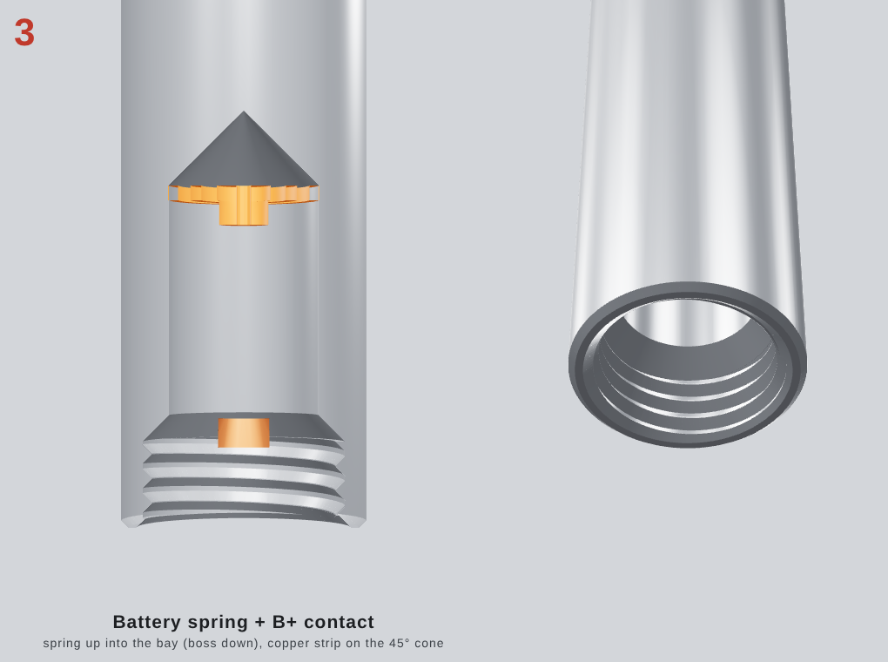
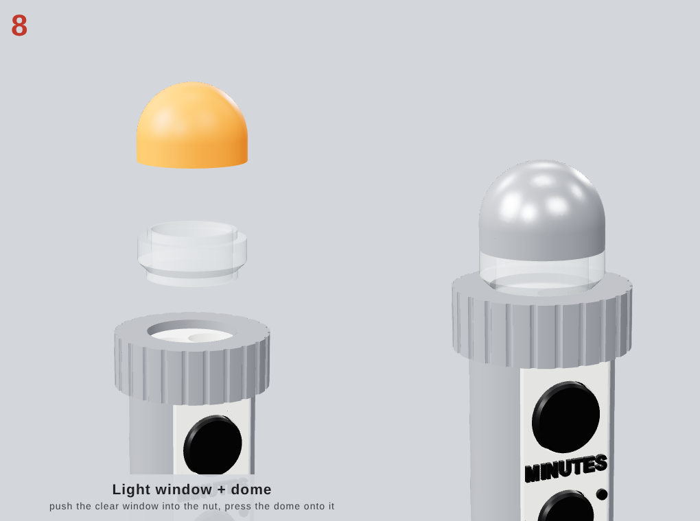
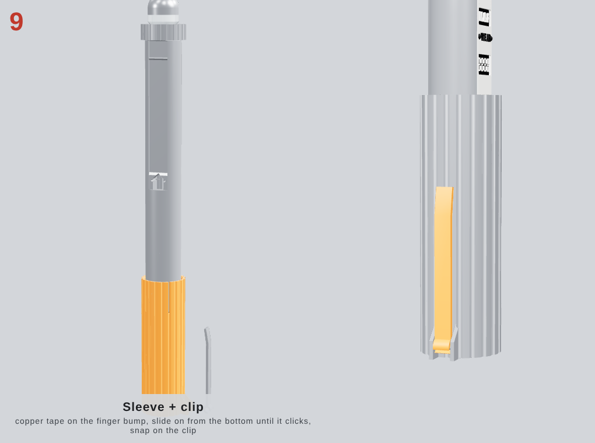
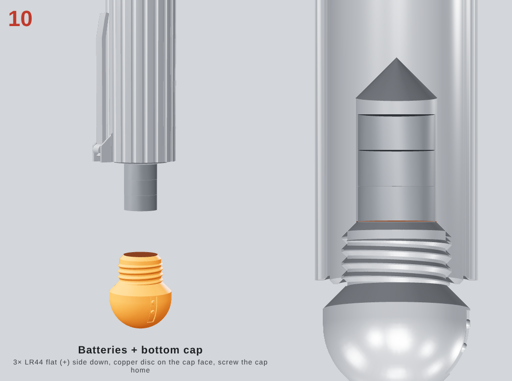
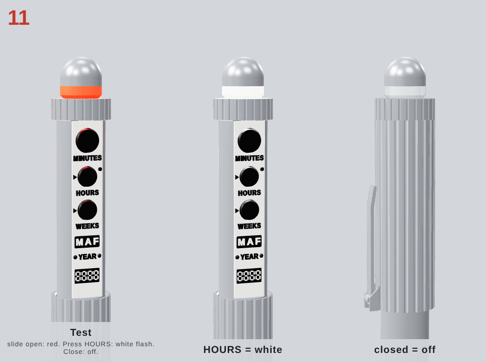

# Assembly tutorial: MIB Neuralizer

About 1.5 hours of bench work after printing. You need:
- soldering iron and solder
- side cutters
- a fine file or deburring tool
- tweezers
- a stiff piece of solid wire, used as a "fish tape" to pull wires through the body
- the copper tape and LR44 cells from the shopping list in [BUILD_GUIDE.md](BUILD_GUIDE.md)

---

## Step 1: Print

Open **`3mf/neuralizer_P1S_PETG_project.3mf`** in Bambu Studio. It loads as a project with 5 plates and 3 filament slots:

| Slot | Filament | Used for |
|---|---|---|
| 1 | **White PETG** | body, sleeve, caps, nut, dome, LED head, clip, spring, panel |
| 2 | **Black PETG** | buttons, panel labels, M A F plate and display floor |
| 3 | **Clear PETG** | light window |

1. **Map the slots.** On *Sync / AMS mapping*, point slot 1 at your white spool, slot 2 at black and slot 3 at clear. Plate 3 (the window panel) is the only plate that switches colours. Every other plate uses a single filament, so you can also print them without an AMS.
2. **Print plate 1 first: the test parts.**
   - The ring with the right number of notches should slide over the stub.
   - The thread ring should spin on by hand.
   - If not, adjust `slide_clr` / `thread_clr` (BUILD_GUIDE.md §7), regenerate, and only then print plates 2–5.
3. **Leave the per-object settings alone.** Each object carries its own layer height, walls, infill and brim (the body and sleeve get a brim and back seams). Supports stay **off**.
4. **Remove the brims** and deburr the sleeve bore and the body's back channel with a fingernail or deburring tool.

**Paint before assembly** (optional, for the chrome look): the body, sleeve, caps, nut, dome and clip.
Mask the **sleeve bore, back channel, contact land, threads and window recess**. Keep the panel unpainted: white with black print matches the reference prop.

---

## Step 2: LED head

1. **White LED:** cut the long leg (+) to 6 mm and solder on the **82 Ω** resistor. Solder a yellow wire (**X**, 60 mm) to the resistor and a black wire (**B−**, 160 mm) to the short leg.
2. **Red LED:** solder the **270 Ω** resistor to the long leg and an orange wire (**N**, 60 mm) to the resistor. Solder a 30 mm black jumper to the short leg.
3. Insulate the joints with heat-shrink or tape.
4. Feed each LED **from the top** into the white LED head, resistor and wires first, until its rim sits on its ledge. The two tips end up side by side, 2.5 mm above the flange.
5. Under the stem, solder the black jumper onto the B− wire. Three wires now leave the head: **N, X and B−**.

## Step 3: Battery spring and the B+ contact

1. Push the fish tape down the wire channel from the top socket until it comes out of the battery bay. Pull the **B− wire** through it, from the top down and out of the bay.
2. Pass the B− wire through the hole in the **spring's boss** from the flat side. Strip 6 mm, fold the bare end flat across the boss, and cover the boss with a 6×6 mm square of copper tape.
3. Push the spring up the bay with a pencil, boss facing down toward you, until it seats under the cone roof. Line up its notch with the groove in the bay wall.
4. Push a **red wire (B+)** in through the **left pad hole** on the back contact land, down the channel and out of the bay.
5. Lay it in the wall groove, strip 8 mm, and lay the end on the **45° cone** just above the thread.
6. Tape over it with a 5 mm copper strip (copper in the picture). The cap presses on this strip.

## Step 4: Sleeve-switch pads

1. Pull the B+ wire's top end 5 mm out of the left pad hole, strip it, and fold it flat into the left recess.
2. Cover it with a copper strip **1.8 mm wide × 8 mm**. Burnish it flat; it must sit flush.
3. Feed a second **orange N wire** (80 mm) through the right pad hole and the cross tunnel into the channel. Finish the right pad the same way.
4. A quick solder tack through the tape improves contact. Keep it quick so the PETG doesn't melt.

## Step 5: HOURS switch

1. Turn the switch so its legs point along the prop (toward the top and bottom). Cut the legs to 1.5 mm.
2. Solder **both N wires** (from the LED head and from pad P2) to one leg, and **X** to a leg on the **opposite** side. Legs on the same side are connected inside the switch.
3. Press the switch, plunger outward, into the square pocket behind the middle hole. It's held by its body and sits on a centre rib.
4. Pull all slack up into the top socket.

## Step 6: Buttons and window panel

1. Drop the three black buttons into the panel **from behind**: the big one into MINUTES. Their flanges keep them captive.
2. Hold the panel face up and slide its **bottom tongue** into the slot at the lower end of the window. Lay it flat; the top tongue drops into the slot in the thread.
3. Press HOURS. You should feel the click.

## Step 7: LED head and knurled nut

1. Tuck the wires into the top socket and push the LED head's stem in. It is keyed and fits only one way.
2. Screw the **knurled nut** down until it clamps the head's flange. The nut also locks the panel's top tongue.

## Step 8: Light window and dome

1. *Optional:* black-marker the inside of the dome's cone for crisper light, or leave it white for a brighter glow.
2. Press the **clear light window**'s lower spigot into the nut.
3. Press the **white dome** onto the window's upper spigot.
4. Both LEDs now sit behind the clear ring: red glows while open, and white flashes through the same window.

## Step 9: Sleeve and clip

1. Stick an 8 × 10 mm copper patch on the **flat face of the finger bump** inside the sleeve's top edge, and wrap the ends around the bump.
2. Slide the sleeve on **from the bottom**, finger end first, with the finger lined up with the back channel.
   The finger flexes about 2 mm and **clicks** into the channel. It's captive from now on: the cap can come off and the sleeve stays on.
3. Push the **clip**'s C-hook onto the hinge bar at the sleeve's bottom-left until it snaps.

## Step 10: Batteries and bottom cap

1. Cut a **16 mm copper disc** and stick it on the cap's flat face. Snip 8 short slits around the edge and fold the tabs onto the 45° cone.
2. Drop in **3× LR44 / SR44, flat side (+) down**, toward the cap.
3. Screw the cap on until it stops (about 3.5 turns). The disc presses the cells and the cone touches the B+ strip.

## Step 11: Test

| Action | Expected |
|---|---|
| Slide the sleeve **down** (open) until it clicks | **red** window |
| Press **HOURS** while open | **white** flash (with red) |
| Slide the sleeve **up** (closed) | everything off, HOURS does nothing |

If something's off, see *Troubleshooting* in [BUILD_GUIDE.md](BUILD_GUIDE.md#10-troubleshooting).
To change batteries, unscrew the cap and tip the cells out.
