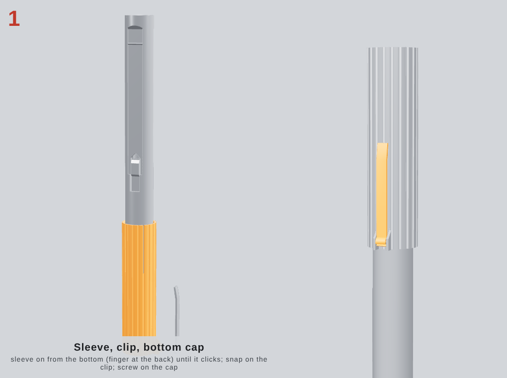
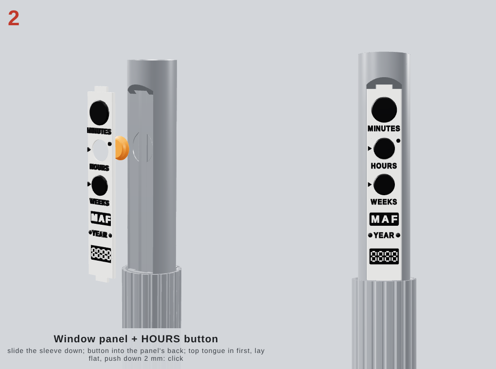
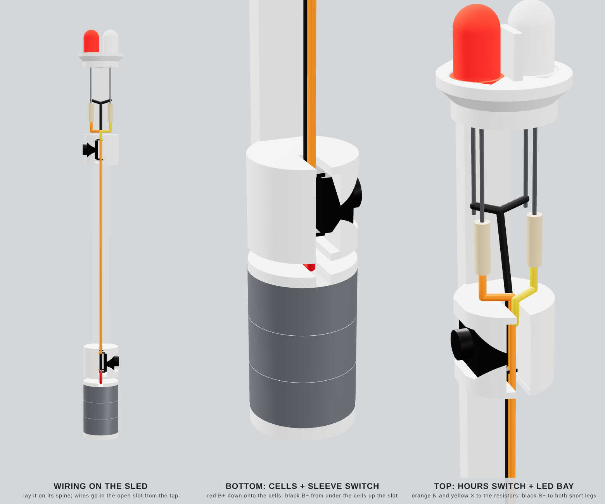
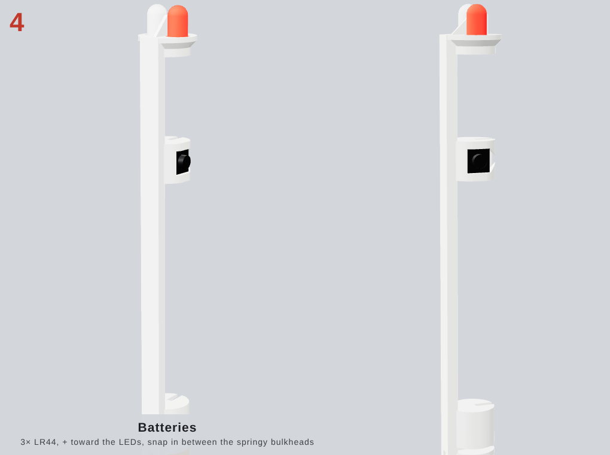
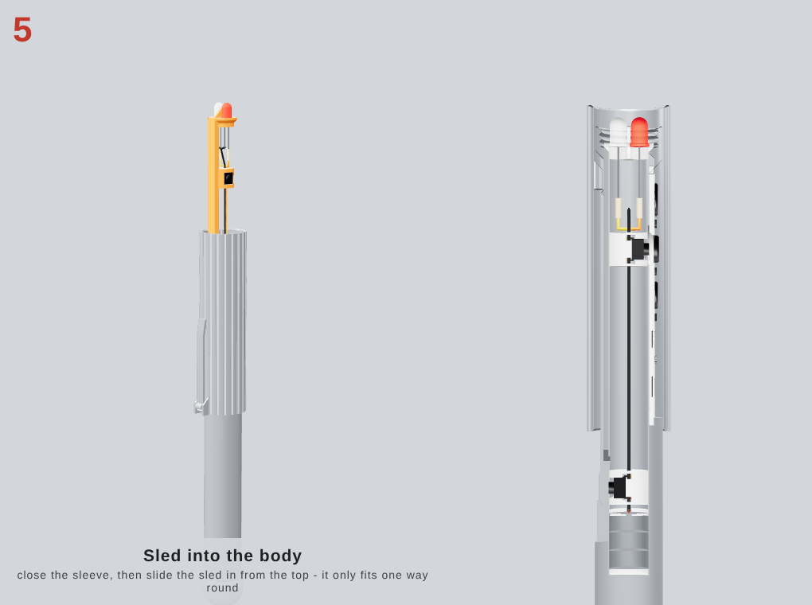
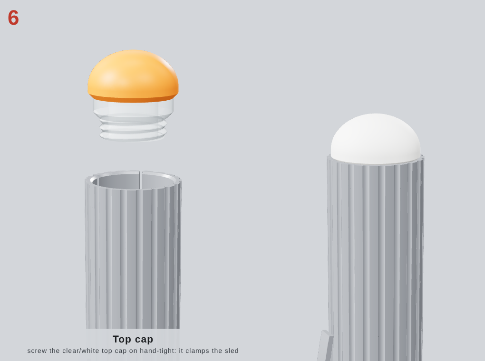
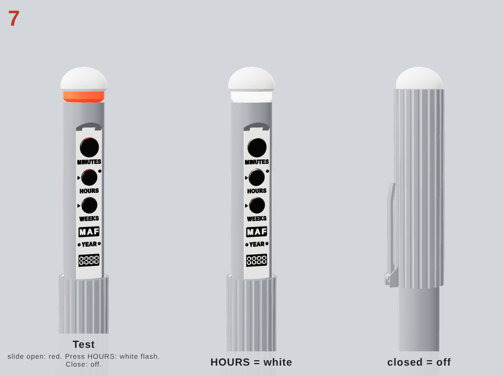

# Assembly tutorial: MIB Neuralizer

**About 20–25 minutes after printing, about 10 of them soldering.** Nothing is threaded through the body any more. All the electronics sit on one printed **sled** that you wire on the bench and then drop into the body from the top. There is no copper tape, no glue, no screws and no springs. The mechanical parts all click or screw together by hand.

You need:
- a soldering iron and solder;
- side cutters;
- your own two 6×6 tactile switches, two 5 mm LEDs (red + white), 2 resistors and a little wire (nothing extra to buy);
- 3 LR44 cells, the only thing on the shopping list in [BUILD_GUIDE.md](BUILD_GUIDE.md).

| Step | What | Time |
|---|---|---|
| 0 | Print | — |
| 1 | Sleeve, clip, bottom cap | 2 min |
| 2 | Window panel + HOURS button | 1 min |
| 3 | Wire the sled | 12–15 min |
| 4 | Batteries | 1 min |
| 5 | Sled into the body | 30 s |
| 6 | Top cap | 30 s |
| 7 | Test | 30 s |

---

## Step 0: Print

Open **`3mf/neuralizer_P1S_PETG_project.3mf`** in Bambu Studio. It loads as a project with 4 plates and 3 filament slots.

| Slot | Filament | Used for |
|---|---|---|
| 1 | **White PETG** | body, sleeve, sled, bottom cap, clip, panel, HOURS button, top-cap dome |
| 2 | **Black PETG** | panel labels and buttons, top of the HOURS button |
| 3 | **Clear PETG** | top-cap spigot and light ring |

1. **Map the slots.** On *Sync / AMS mapping*, point slot 1 at white, slot 2 at black and slot 3 at clear.
   - Plates 3 (panel + HOURS button) and 4 (top cap) use the AMS.
   - Plates 1 and 2 use white only.
2. **Print plate 1 first: the test parts.**
   - The ring with the right number of notches should slide over the stub.
   - The thread ring should spin on by hand.
   - **Switch test:** a 6×6 switch should press snugly into the pocket, with its legs in the slots behind it.
   - If anything is wrong, adjust `slide_clr` / `thread_clr`, or measure the switches (BUILD_GUIDE.md §7–8). Regenerate before printing plates 2–4.
3. **Leave the per-object settings alone.** Supports stay **off**, and nothing needs them: every part is designed so no surface is flatter than 45°.
4. **Remove the brims.** Deburr the sleeve bore and the body's back channel with a fingernail.

**Optional paint** (chrome look): body, sleeve, clip and bottom cap.
- Mask the sleeve bore, the back channel, the threads and the window recess.
- Leave the panel, sled and top cap unpainted.

---

## Step 1: Sleeve, clip, bottom cap

1. **Sleeve:** slide it onto the body from the **bottom**, with the finger at the back in line with the back channel. Push until the finger's bump **clicks** into the channel. From then on it can't fall off.
2. **Clip:** snap it onto the bar on the sleeve.
3. **Bottom cap:** screw it on hand-tight. It is decorative; nothing electrical touches it.

---

## Step 2: Window panel + HOURS button

1. Slide the sleeve **down** (open) so the window is free.
2. **Load the button:** lay the panel face down and drop the HOURS button into the middle hole from behind. Its thin flange sits in the round recess in the panel's back.
3. **Fit the panel:**
   - Hold the button in with a finger.
   - Push the panel's **top tongue** into the slot above the window.
   - Lay the panel flat into the window.
   - Slide it **down 2 mm** until both tongues sit in their slots and the detents **click**.

MINUTES and WEEKS are printed into the panel. Only HOURS moves.

---

## Step 3: Wire the sled

Everything happens on the bench. **Lay the sled on its spine** (the flat bar it printed on), so the round holders stand up like rings. From the bottom end to the top, it holds:
- the **battery bay**: two thin walls with the cells clamped between them;
- the **S1 (sleeve switch) holder**;
- a long bare stretch of spine;
- the **S2 (HOURS) holder**;
- the **LED bay**: an open space under the LED head;
- the **LED head**.

**Where the wires go:**
- **The slot:** every holder has a 1.6 mm slot cut down into its top, in the middle. The wires are simply **laid into those slots from above**, like a cable tray. Between the holders they just lie along the sled.
- **Past the cells:** only one wire (black B−) has to get past the batteries. It runs in a channel **under** the cells, between the two low rails of the spine, and comes up through the slot in the upper battery wall.
- **Wire size:** use thin wire (28–24 AWG, under about 1 mm thick with insulation).

1. **Switches:** trim the legs of both 6×6 switches to about 1.5 mm. Use two legs that are **diagonally opposite**; that pair always switches.
   - **S2 (HOURS):** press it into the pocket in the upper holder, plunger toward the front (the side the panel faces). Its legs sit in the open space behind it.
   - **S1 (sleeve):** press it into the pocket in the lower holder, plunger toward the back.
2. **LEDs and resistors:**
   - Solder the 270 Ω resistor to the red LED's long leg, and the 82 Ω resistor to the white LED's long leg.
   - Push the legs down through the two holes in the LED head until the LED rims sit in their seats. **Red** goes on the same side as the HOURS plunger.
   - The legs and resistors hang down into the LED bay.
3. **Wires**, lengths in the diagram:
   - **B− (black):** strip and tin about 5 mm at one end and lay it flat on the **lower battery wall's** inner face; the cells will press on it. Run the wire along the channel under where the cells go, up through the slot in the **upper** battery wall, then in the slot all the way up to the LED bay. Connect it to **both** LED short legs.
   - **B+ (red):** strip and tin about 5 mm at one end. Bend the end flat against the **upper battery wall's** lower face (feed it down through that wall's slot); the cells' + side presses on it. Run the other end in the slot to one S1 leg.
   - **N (orange):** from the diagonally opposite S1 leg, up the slot to one S2 leg, and on up to the 270 Ω (red) resistor.
   - **X (yellow):** from the diagonally opposite S2 leg up to the 82 Ω (white) resistor.
4. **Test before the batteries go in.** Hold 3 stacked cells between the two tinned ends. Press S1 and red should light; press S1 and S2 together and white should light too.

---

## Step 4: Batteries

Stack **3 × LR44** with **+ (the flat, marked side) up**, toward the switches and LEDs. Push the stack in **sideways** between the two battery walls at the bottom end, over the black wire. The walls flex 0.5 mm and clamp the cells onto the two tinned wire ends; they act as the battery spring.

To change batteries later, undo steps 6 and 5 (cap off, sled out), swap the cells and put it back. That takes about a minute.

---

## Step 5: Sled into the body

1. **Close the sleeve first** (slide it all the way up). When it is open, it pushes the switch tongue into the bore, and the tongue would catch S1.
2. Slide the sled into the top of the body with its spine on the same side as the clip, where it runs in a keyway. It only fits one way round.
3. Push until the LED flange sits on the cone at the top of the bore.

---

## Step 6: Top cap

Screw the top cap (clear ring + white dome) on hand-tight. Its spigot clamps the sled's LED flange, so nothing rattles.

---

## Step 7: Test

| Action | Expected |
|---|---|
| Slide the sleeve **down** | It clicks against its stop and the clear ring glows **red** |
| Press **HOURS** | **White** flash through the same ring |
| Slide the sleeve **up** | Everything goes off, and the panel and ring are hidden: a plain fluted tube |

If something doesn't work, see *Troubleshooting* in [BUILD_GUIDE.md](BUILD_GUIDE.md#10-troubleshooting).
