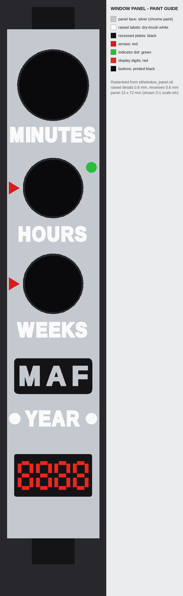

# MIB Neuralizer: Build Guide

A support-free PETG prop for a Bambu Lab P1S. It has no screws, springs, magnets or glue.
- **Sleeve slides down:** the red ring lights (ready).
- **Press HOURS while open:** the white dome flashes.
- **Sleeve closed:** nothing lights.


---

## 0. Assumptions and safe defaults (read this first)

| Topic | What I assumed | Safe default in `neuralizer.scad` |
|---|---|---|
| Tactile switch | No switch photo arrived with the request, so I assumed a standard 6×6 mm through-hole switch: 3.5 mm body, 1.5 mm plunger (5.0 mm total), 0.25 mm travel, legs on two opposite sides | `sw_w=6`, `sw_body_h=3.5`, `sw_plunger_h=1.5`, `sw_travel=0.25`. **Measure yours** (section 8). |
| Battery | 1 AA (1.5 V) can't light either LED. 2 AAA (3 V) leaves almost no headroom for a white LED plus resistor. A 4.5 V stack of 3 AA/AAA cells is 133–150 mm long and won't fit a slim prop. | **3 × LR44 / SR44 button cells = 4.5 V**, a 16 mm stack. `battery` is a parameter: `LR44x3`, `LR44x4` (6 V), `A23` (12 V), `AAAx3` (4.5 V, makes the body 245 mm long). |
| LEDs | Standard 5 mm through-hole LEDs: red Vf ≈ 2.0 V, white Vf ≈ 3.1 V, long leg = + | `led_d=5`, `led_rim_d=5.8`, `led_len=8.6` |
| Copper tape | Copper foil tape with conductive adhesive, about 0.1 mm thick | `tape_t=0.1` (depth of the pad recesses) |
| PETG fits | PETG needs more clearance than PLA | sliding 0.35 mm radial (0.7 mm on diameter), threads 0.25 mm per flank, button holes 0.25 mm, locating fits 0.15 mm |
| Size | About 192 mm long, 20 mm inner body, 24.6 mm fluted sleeve, matching your references | `body_d`, `window_len`, `sleeve_od` … |
| Threads | Printed, not metric. 90° included angle (45° flanks print without supports), 2 mm pitch | bottom Ø16, top Ø19, `thread_clr=0.25` |
| Wires | The circuit as you specified needs node **N** (between the two switches) at the top, for the red LED. So **3 wires** leave the LED head: the two push-button wires (N, X) plus battery − (B−). | Wire channel 3.2 × 3.4 mm |
| Clip side | Left side when you face the window, like your product photo | |

---

## 1. Files

| Path | What it is |
|---|---|
| `neuralizer.scad` | The parametric model. Open it, then use *Window → Customizer*. Set `part` to export one part. |
| `stl/*.stl` | Print-ready parts, already in print orientation (13 parts + 2 test prints) |
| `VERIFICATION.md` | Proof report: collisions, threads, mechanisms, overhangs, bed fit, text stroke widths |
| `images/` | Previews, cutaway, exploded view, wiring diagram, panel paint guide |
| `tools/` | `build_stl.sh` (exports all STLs), `export_assembled.sh` + `verify.py` (the proof), renderers |

Re-run everything after changing a parameter (needs OpenSCAD and `pip install trimesh manifold3d scipy scikit-image pillow`):

```bash
cd neuralizer && tools/build_stl.sh && tools/export_assembled.sh && python3 tools/verify.py
```

---

## 2. Shopping list (only what you said you don't have)

| Item | Qty | Notes |
|---|---|---|
| **LR44 button cells** (also sold as A76, AG13, L1154, 357; **SR44** silver-oxide is best) | 3 + spares | SR44/357 holds its voltage better under load. All of these are the same size. |
| **Copper foil tape, 5–6 mm wide, with conductive adhesive** | ~1 m | For the sleeve switch, battery contacts and spring pad |
| Spray filler-primer (grey) + gloss black + chrome/bright-silver spray | 1 can each | For the silver look (section 5) |
| Paint markers: black, white, red, green (fine tip) | 1 each | Panel details |
| Wet/dry sandpaper 240 / 400 / 800 | 1 each | |
| *Optional:* 28 AWG silicone wire in 4 colours, small heat-shrink | | Much easier to thread than stiff 22 AWG solid wire. 22 AWG does fit. |
| *Optional:* graphite powder or a dab of silicone grease | | Smoother slide |

---

## 3. Print plan (Bambu Lab P1S, PETG, 0.4 mm nozzle, **supports OFF**)

Use Bambu Studio's *Generic PETG* (or Bambu PETG HF) profile on the **textured PEI plate**. On smooth PEI, use glue stick as a release agent.
Set elephant-foot compensation to 0.15 mm, put the seam on the back ("aligned" + painted seam), and set the bridge fan to 100%.
Every STL is already in its print orientation. Just drop it on the plate.

**Print the two test parts first (≈ 30 min):** `fit_test.stl` and `thread_test.stl` (section 7).

| Part | Colour | Orientation (as exported) | Layer | Walls | Infill | Notes |
|---|---|---|---|---|---|---|
| `body` | white | upright, battery end down | 0.16 | 4 | 15 % gyroid | **5 mm brim** (tall and slim). Seam on the back. |
| `sleeve` | white | upright, **top edge down** | 0.16 | 3 | 15 % gyroid | Seam on the back, inside a flute. Upside-down printing keeps the finger bump's stop face sharp. |
| `bottom_cap` | white | contact face down, dome up | 0.12 | 4 | 30 % | Fine layers for the thread |
| `knurl_nut` | white | lip down | 0.12 | 4 | 30 % | |
| `window_panel` | white | face up | 0.12 | 3 | 100 % | Fine layers give crisp text. No ironing. |
| `clip` | white | on its side | 0.12 | 3 | 100 % | |
| `battery_spring` | white | flat, boss up | 0.12 | 2 | 100 % | |
| `led_mount` | **black** | stem down | 0.12 | 3 | 30 % | Black = opaque light baffle |
| `btn_minutes`, `btn_hours`, `btn_weeks` | **black** | flange down | 0.12 | 2 | 100 % | |
| `red_band` | **transparent** | upright | 0.16 | 2 | 100 % | Slow (≤ 60 mm/s) for clarity |
| `dome` | **transparent** | open end down | 0.16 | 2 | 100 % | Solid dome = even glow. No overhangs. |

All white parts fit on one plate, black on a second and transparent on a third. Total is roughly 50 g white, 3 g black and 3 g transparent.
Overhang scan: no part has a down-facing surface steeper than 50° except short bridges: the LED-head baffle and small internal pocket roofs. See `VERIFICATION.md` §2.

---

## 4. Wiring


**Resistors** (the model prints these with `echo` when you change `battery`):

| `battery` | Voltage | Red LED (≈ 9 mA) | White LED (≈ 17 mA) | Body length |
|---|---|---|---|---|
| **LR44x3 (default)** | 4.5 V | **270 Ω** | **82 Ω** | 156 mm |
| LR44x4 | 6 V | 470 Ω | 150 Ω | 156 mm |
| A23 | 12 V | 1 kΩ | 470 Ω | 156 mm |
| AAAx3 | 4.5 V | 270 Ω | 82 Ω | 245 mm |

If you don't have the exact value, use the next value **up** (e.g. 100 Ω instead of 82 Ω, 330 Ω instead of 270 Ω). The LED will only be slightly dimmer.
Never go below 220 Ω for red or 68 Ω for white at 4.5 V.

---

## 5. The silver look

You have white, black and transparent PETG, so the silver is **paint** (a silver PETG would also work).
1. Sand the white parts 240 → 400. Use filler-primer, then 800 wet.
2. Spray gloss black, then chrome or bright silver in light coats. Leave the knurled nut and flutes slightly darker for depth.
3. **Do not paint** the sliding surfaces: the **sleeve bore**, the **key channel and contact land**, the **threads**, or the **button holes**.
   Mask them with tape or a paper tube. Paint on both sliding faces eats ~0.2 mm of the 0.35 mm clearance.
   If you want to fully paint the lower body (it shows when closed), keep it to one thin silver coat, or set `slide_clr=0.45`.
4. Window panel: follow `images/panel_paint_guide.png`.
   - Paint the face silver.
   - Fill the M A F plate and display recesses with black marker.
   - Lightly sand the tops of the **M A F letters** (they're flush with the face) so they show silver.
   - Dry-brush the raised labels white. Arrows are red, the dot is green, display digits are red.
5. Transparent parts: leave them clear, or frost the outside with 400 grit for a softer glow.
   **Black-marker the top face of the red band**. This stops red light creeping into the dome.



---

## 6. Assembly order


**A. LED head (on the bench)**
1. White LED:
   - Trim the legs to 8 mm.
   - Solder the **82 Ω** resistor to the **long leg (+)**.
   - Solder the **X** wire (yellow) to the resistor.
   - Solder a **B−** wire (black, ~150 mm) to the short leg.
2. Red LED:
   - Solder the **270 Ω** resistor to the long leg.
   - Solder the **N** wire (orange, ~40 mm) to the resistor.
   - Solder a short black jumper to the short leg.
3. Insulate the joints with heat-shrink or tape.
4. Push each LED **from the top** into `led_mount`, with the resistor and wires going down the bore:
   - White goes into the tall tube. Its rim sits on the ledge.
   - Red goes into the other bore. Its tip ends just under the baffle.
5. Below the stem, join the red jumper to the B− wire. That makes 3 wires out of the head: **N, X, B−**.

**B. Body wiring** (feed wires with a stiff piece of solid wire as a "fish tape")
1. **B− (battery spring):**
   - Feed the B− wire down the wire channel from the top socket until it comes out of the battery bay.
   - Thread it through the hole in the spring's boss (from the flat side), strip 6 mm, and fold it flat across the boss.
   - Cover the boss with a 6×6 mm square of copper tape.
   - Push the spring (boss toward you, i.e. toward the cells) up the bay with a pencil until it seats under the cone roof. The notch goes at the wire groove.
2. **B+ (battery cone):**
   - Push a red wire into the **left pad hole** on the contact land, down the channel and out of the bay.
   - Lay it in the groove in the bay wall, strip 8 mm, and lay the end on the **contact cone** (the 45° ring just above the thread).
   - Stick a 5 mm copper tape strip over it, along the cone and a little way up the groove.
3. **Pads P1/P2:** on the contact land (back, just below the window):
   - Pull the red wire's top end 5 mm out of the left hole, strip it and fold it flat.
   - Cut copper tape strips **1.8 mm wide × 8 mm** and lay one in the left pad recess, over the wire. A quick solder tack through the tape is fine; keep it quick so the PETG doesn't melt.
   - Do the same on the right pad with a second orange **N** wire (~80 mm). Its other end goes to the HOURS switch.
   - The tape must sit flush in the 0.1 mm recesses. Burnish it down with a fingernail.
4. That second **N** wire runs from the right pad through the cross tunnel into the channel, then up to the HOURS pocket.
5. **HOURS switch (S2):**
   - Turn it so the legs point along the prop (toward top and bottom). Cut the legs to 1.5 mm.
   - Solder **both N wires** (from the LED head and from pad P2) to one leg, and **X** to a leg on the **other** side. Legs on the same side are internally connected.
   - Press the switch, plunger out, into the pocket behind the middle button hole. It's held by its body and sits on the centre rib.
6. Pull the slack wire up into the top socket.

**C. Window**
1. Put the three black buttons into the panel **from behind** (big one at MINUTES). The flanges keep them captive.
2. Slide the panel's bottom tongue into the slot at the bottom of the window, then lay the panel flat. The top tongue drops into the slot in the thread.

**D. Top**
1. Push the LED head stem into the top socket. It is keyed and only fits one way. Tuck the wires in.
2. Screw on the **knurled nut**. Its lip clamps the LED head and covers the panel's top tongue.
3. Slip on the **red band**, then press the **dome** onto the black baffle (push-fit).

**E. Sleeve and switch**
1. Stick an 8 × 10 mm piece of copper tape on the **flat face of the finger bump** inside the sleeve's top edge, wrapping the ends around the bump.
2. Slide the sleeve on **from the bottom**, finger end first (the clip lugs trail at the bottom), with the finger lined up with the back channel.
   The bump rides up the body (the finger flexes about 2 mm) and **clicks** into the channel. It's captive from then on.
3. Snap the **clip**'s C-hook onto the hinge bar at the sleeve bottom, left side.

**F. Batteries**
1. Drop in 3 × LR44 **flat side (+) down**, toward the cap.
2. Screw on the bottom cap until it stops (about 3.5 turns). Its face (copper-taped, see below) presses the cells, and its cone presses the B+ pad.
   - **Cap contact:** cut a 16 mm disc of copper tape and stick it on the cap's flat face.
   - Make 8 short radial snips around the edge and fold the tabs onto the 45° cone.
3. Test:
   - Slide open: **red** lights.
   - Press HOURS: **white** flashes.
   - Close: everything is off.

**Swapping batteries:** unscrew the cap and tip out the cells. The sleeve can't fall off (the finger stop holds it) and the spring stays in.

**Fallback sleeve switch:** if the tape contact is unreliable, put a second 6×6 switch in the **pocket in the middle of the contact land**, plunger out.
Pull the P1 and P2 wires out through the pocket (their holes break into it) and solder them to two opposite legs.
The bump then presses the plunger 0.85 mm when fully open. Use no tape on the bump in this mode.


---

## 7. Getting the sliding fit right (PETG)

1. **Print `fit_test.stl`**: a body stub with the key channel plus three sleeve rings. One notch = `slide_clr − 0.1`, two = the current value, three = `+ 0.1`.
   - The right ring slides over the stub under its own weight, with barely any wobble.
   - Set `slide_clr` to that ring's value and re-export (`tools/build_stl.sh`).
2. **Print `thread_test.stl`**: the real bottom-cap thread. The ring should spin on by hand with no tools.
   - Too tight: raise `thread_clr` by 0.05.
   - Sloppy: lower it by 0.05.
   - The same `thread_clr` drives both end-cap threads.
3. Keep elephant-foot compensation on (0.15 mm). Otherwise the sleeve's first layers are tight on the body.
4. Put the seam on the back and inside a flute. Scrape off any seam blob in the sleeve bore with a deburring tool.
5. A few strokes of 400 grit on the body and a pinch of graphite give a buttery slide.
6. **Detent and contact force** come from the finger flexing:
   - `finger_preload` (0.5 mm) bends the finger on the contact land. That gives ≈4 N of contact force and holds it open.
   - The 0.65 mm ridge near the top holds it closed.
   - Too stiff: lower `finger_preload` to 0.4. Lights flicker: raise it to 0.6.
7. **Don't paint inside the sleeve or the channel** (section 5).

---

## 8. Measure your tactile switch (calipers)

1. **Body width**, flat to flat. Expected 6.0. If different → `sw_w`.
2. **Body height**: from the bottom of the plastic body (not the legs) to the top of the body, where the plunger starts → `sw_body_h`. Typical 3.5.
3. **Total height** to the top of the plunger. `sw_plunger_h` = total − body.
   Common totals: 4.3, 5.0, 6.0, 7.0, 8.0, 9.5 mm. The model assumes 5.0.
4. Press it slowly and watch the plunger. Travel to the click → `sw_travel`, typically 0.25.

The HOURS pocket depth, the button travel stop and the fallback pocket all follow these values automatically. Re-run `verify.py` to confirm.

---

## 9. What was verified (see `VERIFICATION.md` for numbers)

- All 15 STLs are closed manifold solids, sitting on the bed. All fit 256 × 256 × 256 mm; the tallest is the 156 mm body.
- **Collisions:** all 136 part pairs in the **open** and **closed** positions, including dummy cells, LEDs and switches with leg shoulders. The only overlaps are the designed ones:
  - the spring pressed on the cells (0.8 mm);
  - the finger bump pressed on the contact land (0.5 mm preload);
  - the press fits of the spring disc and the dome.
- **Threads** (both end caps):
  - screwing off along the helix, checked every 30° over 4–4.5 turns: **zero overlap**;
  - pulling straight off without turning: **collides**, so the teeth really interlock;
  - turning without advancing: **collides**, so pitch and handedness match;
  - 0.51 mm radial engagement.
- **Mechanisms:**
  - HOURS pushes the plunger 0.35 mm (> 0.25 mm travel) and stops on its flange, so the switch isn't crushed. The cap is captive.
  - Open and closed end-stops work, the closed detent engages, and the window is fully covered or fully revealed.
  - The fallback switch gets pressed 0.85 mm.
  - LED tips sit where they should.
  - The clip snap has 0.25 mm of interference.
- **Text:** every raised label, arrow, M A F letter and display segment survives a 0.42 mm "nozzle line" sweep. Every letter is its own island. Median strokes are 0.55–0.74 mm.
- The other battery variants (`LR44x4`, `A23`, `AAAx3`) were rebuilt and pass the same checks.

## 10. Troubleshooting

| Symptom | Fix |
|---|---|
| Red flickers while open | Burnish the pad tape flat. Make sure the bump tape wraps over its edges. Raise `finger_preload` to 0.6, or use the fallback switch. |
| Nothing lights | Check the battery orientation (flat + side toward the cap). Check that the cap tape touches the cone pad: screw the cap fully home. |
| Red is on but white never flashes | Check that S2 is wired to legs on **opposite** sides. Check the button rests on the plunger: if your switch is shorter than 5.0 mm, set `sw_plunger_h`. |
| White glows faintly with red | Black-marker the band's top face. Make sure the white LED is fully seated in its tube. |
| Sleeve won't click on | Ease the bump's 45° lead-in with a file. It needs about 2 mm of finger flex. |
| Nut or cap is tight | Raise `thread_clr` to 0.3 and reprint that part only. The body's threads are cut by the same value. |
