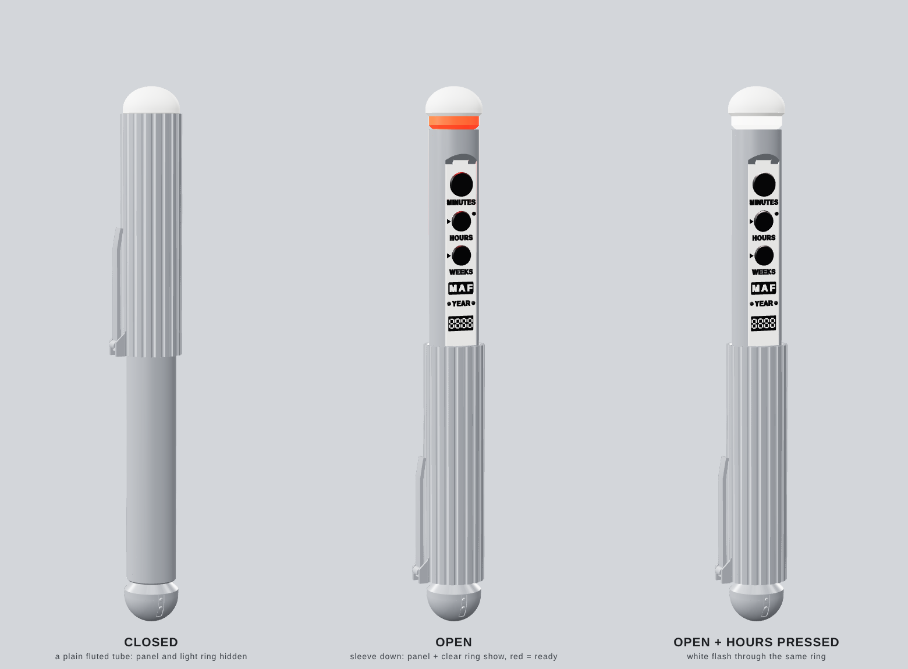
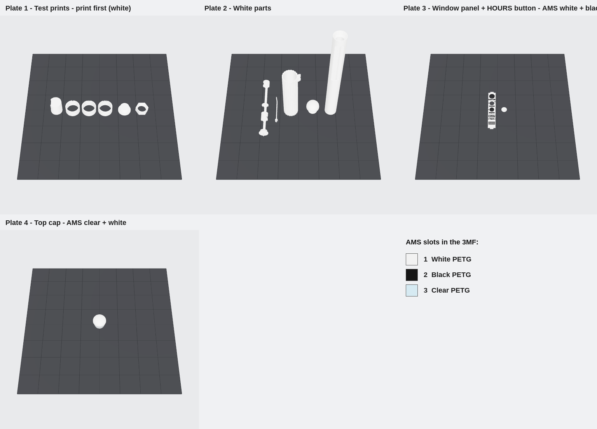
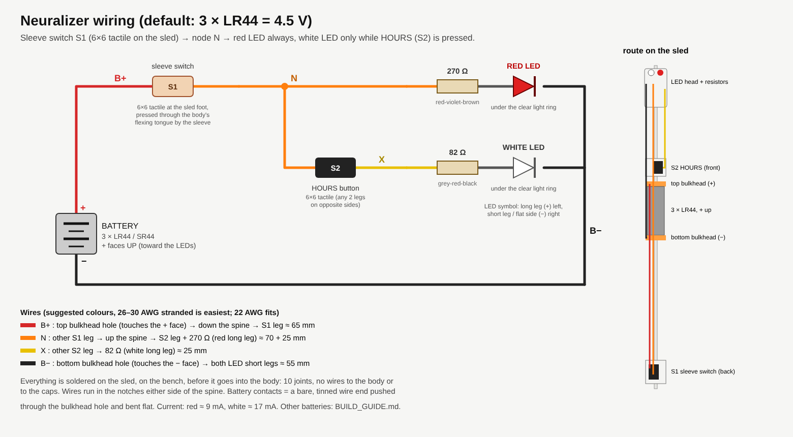
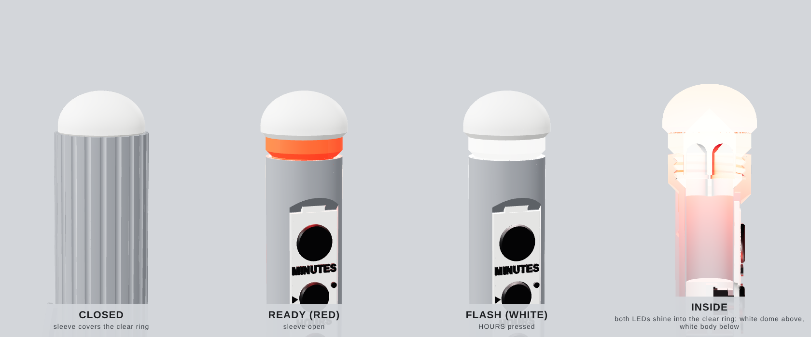
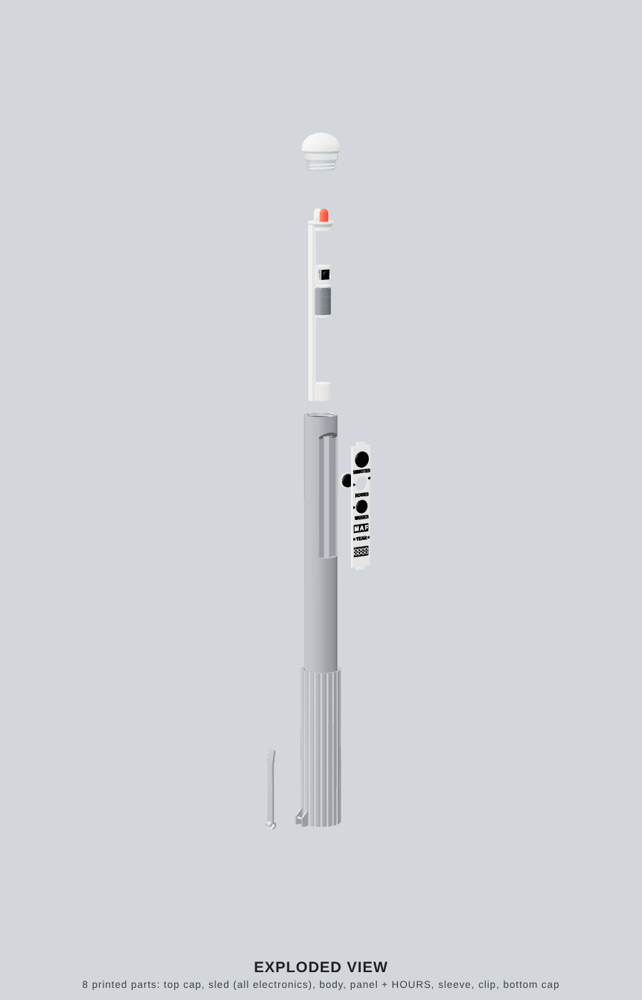
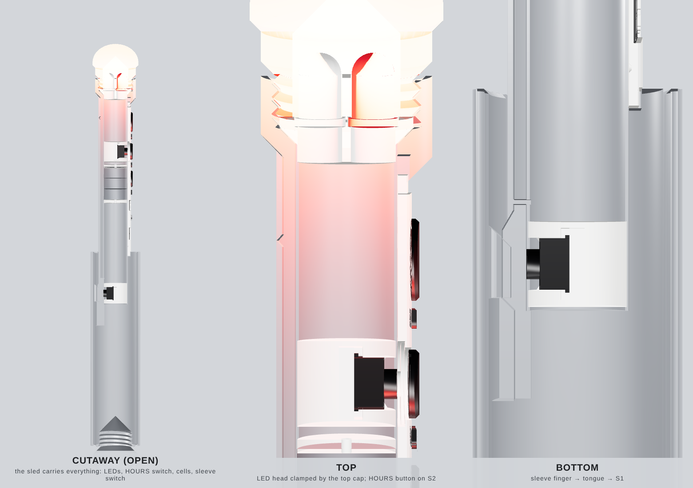

# MIB Neuralizer: Build Guide

A support-free PETG prop for a Bambu Lab P1S. It has no screws, springs, magnets, glue or copper tape.
- **Sleeve closed:** a plain fluted metal-look tube. The panel and the light ring are hidden and nothing lights.
- **Sleeve slides down:** the window panel and the clear ring under the white dome appear, and the ring glows **red** (ready).
- **Press HOURS while open:** a **white** flash shines through the same ring.



**Quick start:**
1. Open `3mf/neuralizer_P1S_PETG_project.3mf` in Bambu Studio.
2. Map AMS slot 1 to white, slot 2 to black and slot 3 to clear PETG.
3. Print plate 1 (the test parts), then plates 2–4.
4. Assemble with [ASSEMBLY.md](ASSEMBLY.md), about 20–25 minutes.

**Why assembly is quick now:** every electrical part sits on one printed **sled** that you wire on the bench, out in the open. It slides into the body from the top and the top cap clamps it. Nothing is threaded through the body, and there is no copper tape and no wire into the caps. The battery is changed by pulling the sled out.

---

## 0. Assumptions and safe defaults

| Topic | What I assumed | Safe default in `neuralizer.scad` |
|---|---|---|
| Tactile switches | 2 × standard 6×6 mm through-hole switches: 3.5 mm body + 1.5 mm plunger (5.0 mm total), 0.25 mm travel, legs on two opposite sides, legs trimmed to 1.5 mm | `sw_w=6`, `sw_body_h=3.5`, `sw_plunger_h=1.5`, `sw_travel=0.25`. **Measure yours** (§8). |
| Battery | 1 AA (1.5 V) can't light the white LED, and a 4.5 V stack of AAA cells won't fit a slim prop. | **3 × LR44 / SR44 = 4.5 V**. `battery`: `LR44x3`, `LR44x4` (6 V), `A23` (12 V). The prop is the same length for all three. |
| Battery contacts | A tinned wire end through a hole in each bulkhead, bent flat. The two bulkheads flex 0.5 mm, so they are the battery spring. | `batt_preload=0.5` |
| LEDs | 5 mm through-hole; red Vf ≈ 2.0 V, white Vf ≈ 3.1 V; long leg = + | `led_d=5`, `led_rim_d=5.8`, `led_len=8.6` |
| Sleeve switch | The sleeve's finger pushes a flexing tongue in the body's back wall onto switch S1 on the sled. It only clicks at full open. | `pad_press=1.0`, `tongue_t=1.4` |
| Top look | White dome, one **clear light ring** below it, white/silver body below that. The sleeve covers the ring when closed. | `window_h=5` |
| Colours | White, black and clear PETG. AMS for the panel (white/black), the HOURS button (white/black) and the top cap (clear/white). | slots 1/2/3 in the 3MF |
| PETG fits | PETG needs more clearance than PLA | sliding 0.35 mm radial, sled 0.25 mm, threads 0.25 mm per flank, button hole 0.25 mm |
| Size | **≈ 216 mm long**, 20 mm body, 24.6 mm fluted sleeve. Longer than before, because the sleeve now has to cover the light ring as well. | `body_d`, `window_len`, `sleeve_od` |
| Threads | Printed, 90° included angle (45° flanks print without supports), 2 mm pitch | bottom Ø16, top Ø17, `thread_clr=0.25` |

---

## 1. Files

| Path | What it is |
|---|---|
| **`3mf/neuralizer_P1S_PETG_project.3mf`** | **Bambu Studio project.** 4 plates, 3 filament slots, per-object settings, multicolour panel, HOURS button and top cap, plate thumbnails |
| `3mf/parts/*.3mf` | One 3MF per part, for any slicer. Carries colour and print settings. |
| `ASSEMBLY.md` | Step-by-step assembly tutorial with pictures |
| `neuralizer.scad` | The parametric model (*Window → Customizer*) |
| `stl/*.stl` | The same parts as STL, in print orientation (plus the colour splits) |
| `VERIFICATION.md` | Proof report: collisions, threads, mechanisms, overhangs, bed fit, text, 3MF validation |
| `VERIFICATION_LR44x4.md`, `VERIFICATION_A23.md` | The same report for the other battery options |
| `images/` | Previews, top ring, cutaway, exploded view, print plates, wiring, assembly steps |
| `tools/` | `build_stl.sh`, `export_assembled.sh`, `verify.py`, `make_3mf.py`, `check_3mf.py`, renderers |

Rebuild everything after changing a parameter. You need OpenSCAD plus `pip install trimesh manifold3d scipy scikit-image pillow lib3mf`.

```bash
cd neuralizer && tools/build_stl.sh && tools/export_assembled.sh && python3 tools/verify.py && python3 tools/make_3mf.py && python3 tools/check_3mf.py
```

To build another battery option, run the same command with `BATTERY=LR44x4` (or `A23`) in front of it.

---

## 2. Shopping list

| Item | Qty | Notes |
|---|---|---|
| **LR44 button cells** (also sold as A76, AG13, L1154, 357; **SR44** silver-oxide is best) | 3 + spares | |
| 6×6 mm tactile switch, through-hole, 5 mm total height | 2 | One for HOURS, one for the sleeve |
| 5 mm LED, red + white | 1 each | |
| Resistors 270 Ω + 82 Ω (¼ W or smaller) | 1 each | Values for other batteries in §4 |
| 28 AWG silicone wire, 4 colours | ~30 cm | Any thin wire works |
| Spray filler-primer + gloss black + chrome/bright-silver spray | 1 can each | Only for the chrome look (§5) |
| *Optional:* graphite powder | | Smoother slide |
| *Optional:* red paint marker | | Arrows / display digits, if you want them red like the film prop |

---

## 3. Print plan: what's in the 3MF project



| Plate | Filament | Parts | Notes |
|---|---|---|---|
| **1 Test prints** (print first) | 1 white | `fit_test`, `thread_test` | ≈ 30 min. Tune the fits before the long prints (§7). |
| **2 White parts** | 1 white | body, sleeve, sled, bottom cap, clip | The body prints standing, with a 5 mm brim. The sleeve prints top-edge down. The sled lies on its spine. |
| **3 Panel + HOURS button** | **1 white + 2 black (AMS)** | window panel, HOURS button | Panel: black from the face up (labels, button heads, plates). Button: printed head-down, black head, white flange. |
| **4 Top cap** | **3 clear + 1 white (AMS)** | top cap | Clear spigot and light ring, white dome. One colour change. |

The settings are stored per object, so you don't have to set anything:

| Object | Layer | Walls | Infill |
|---|---|---|---|
| body, sleeve | 0.16 | 4 / 3 | 15 % gyroid |
| sled | 0.16 | 3 | 30 % gyroid |
| bottom cap | 0.12 | 4 | 30 % gyroid |
| panel | 0.12 | 3 | 100 % |
| HOURS button, clip | 0.12 | 2–3 | 100 % |
| top cap | 0.16 | 3 | 100 % (even glow) |

- **Global settings:** printer *Bambu Lab P1S 0.4 nozzle*, process *0.16mm Optimal*, filament *Generic PETG* ×3 (swap in your own brand's preset if you like), Textured PEI plate, supports off.
- **Purge volumes** are pre-set for white ↔ black and clear → white.
- **Without an AMS:**
  - **Plate 3:** set the black parts to filament 1 (right-click → *Change filament*), then colour the raised details with a black paint marker.
  - **Plate 4:** print it all clear, or use a pause / filament change at the dome's first layer.
- **Clearances** are tuned for PETG. If plate 1 shows a different fit, change `slide_clr` / `thread_clr` and regenerate (§1).

---

## 4. Wiring



All 10 solder joints are on the sled, made on the bench. S1 (sleeve) feeds node N: the red LED is always on N, and the white LED is on N only through S2 (HOURS).

| `battery` | Voltage | Red LED (≈ 9 mA) | White LED (≈ 17 mA) | Prop length |
|---|---|---|---|---|
| **LR44x3 (default)** | 4.5 V | **270 Ω** | **82 Ω** | ≈ 216 mm |
| LR44x4 | 6 V | 470 Ω | 150 Ω | ≈ 216 mm |
| A23 | 12 V | 1 kΩ | 470 Ω | ≈ 216 mm |

If you don't have the exact value, use the next value **up** (e.g. 100 Ω for 82 Ω, 330 Ω for 270 Ω). Don't go below 220 Ω (red) or 68 Ω (white) at 4.5 V.

---

## 5. Finish (aesthetics)



- **Unpainted, straight off the printer:** a white body with a black-lettered panel and black buttons, and a white dome over a clear ring.
- **Chrome look** (film prop):
  1. Sand the body, sleeve, bottom cap and clip 240 → 400, apply filler-primer, then sand 800 wet.
  2. Spray gloss black, then chrome in light coats.
  3. **Mask** the sleeve bore, the body's back channel and tongue, the threads, the window recess and the bore.
- **Leave unpainted:**
  - the **top cap** (white dome + clear ring), which is the light;
  - the **window panel**, which is white with black print;
  - the **sled**, which is hidden.
- **Light ring:** leave it glossy for a crisp ring, or frost it with 400 grit for a softer, even glow. The white cone inside the dome reflects the light outward through the ring.

---

## 6. Assembly

Follow **[ASSEMBLY.md](ASSEMBLY.md)**: 7 illustrated steps, about 20–25 minutes.




---

## 7. Getting the sliding fit right (PETG)

1. **`fit_test`** (plate 1) is a body stub plus three sleeve rings: 1 notch = `slide_clr − 0.1`, 2 = current, 3 = `+ 0.1`.
   - The right ring slides under its own weight with barely any wobble.
   - Set `slide_clr` to its value.
2. **`thread_test`** is the real bottom-cap thread. It should spin on by hand. Tight → `thread_clr` + 0.05; sloppy → − 0.05.
3. Keep elephant-foot compensation on (the profile default). Seams are set to *back*, so deburr the sleeve bore seam.
4. A few strokes of 400 grit on the body and a pinch of graphite give a buttery slide.
5. **Sleeve switch force:**
   - At full open, the bump presses the tongue's pad in by `pad_press` = 1.0 mm. That moves the S1 plunger 0.4–0.6 mm, depending on the switch force; it needs 0.25 mm to click.
   - If S1 doesn't click, raise `pad_press` to 1.2.
6. **Sled fit:** the sled should slide in and out freely. If it's tight, raise `sled_clr` by 0.05.
7. Don't paint inside the sleeve, the channel or the bore.

---

## 8. Measure your tactile switch (calipers)

1. **Body width**, flat to flat → `sw_w` (6.0).
2. **Body height**, from the bottom of the plastic body (not the legs) to where the plunger starts → `sw_body_h` (3.5).
3. **Total height** to the plunger top. `sw_plunger_h` = total − body. Common totals: 4.3 / 5.0 / 6.0 / 7.0 / 8.0 / 9.5 mm.
4. **Travel to the click** → `sw_travel` (0.25).

The pockets, the HOURS button stem and the S1 tongue gap all follow automatically. Rebuild and re-run the checks (§1).

---

## 9. What was verified (numbers in `VERIFICATION.md`)

- **STLs:** all are closed manifold solids, on the bed, and fit within 256 mm³. The body is the tallest part at 182 mm.
- **Collisions:** every part pair in the **open** and **closed** positions, including dummy cells, LEDs, and switches with legs. The only overlaps are the designed ones:
  - the sleeve bump pressing the tongue pad;
  - the bulkheads pre-loading the cells.
- **Sled:**
  - With cells, switches and LEDs fitted, it slides all the way out of the body, past the panel and the HOURS button, with zero overlap (checked every 2 mm).
  - Turned 180°, it doesn't fit, so it can only go in the right way round.
  - The top cap clamps it.
- **Threads:** screwing off along the helix every 30° gives zero overlap. Pulling straight off or turning without advancing both collide, so the teeth are engaged. Engagement is 0.51 mm.
- **Switches:**
  - **HOURS:** it rests on the S2 plunger, presses it 0.35 mm (> 0.25 mm travel) and stops on its flange.
  - **Sleeve switch:** the spring model (finger + tongue) clicks S1 for 160–360 gf switches. Half-open releases it.
- **Sleeve:**
  - **Closed:** it covers the panel **and** the clear ring.
  - **Open:** both are fully visible.
  - The detent, both end-stops and the clip snap all work.
- **LEDs:** both LED tips sit inside the clear ring.
- **Multicolour:** the white/black and clear/white splits rebuild each part exactly, with no overlap. Every letter is a separate island, and no stroke is thinner than a 0.4 mm nozzle line.
- **Battery options:** `LR44x4` and `A23` pass the same full report.
- **3MF:**
  - All files pass a strict read by **lib3mf** (the 3MF Consortium library).
  - The project follows Bambu Studio's loader rules: application tag, full P1S/PETG config, parts ↔ components, filament slots, plates inside the beds, no overlaps.
  - Every mesh is identical to the verified STLs.

## 10. Troubleshooting

| Symptom | Fix |
|---|---|
| Nothing lights | Check the cells: + (flat, marked side) toward the LEDs. Check that both bent wire ends touch the cell faces. Test the sled out of the body. |
| Red doesn't come on when open | Make sure the sleeve is all the way down (it clicks on its stop). If S1 still doesn't click, set `pad_press` = 1.2 and reprint the body. |
| Red works, white never flashes | Make sure S2 is wired to legs on **opposite** sides. If your switch is shorter than 5 mm total, set `sw_plunger_h`. |
| Ring glow is dim or patchy | Frost the ring. Keep the dome unpainted. Use SR44 cells. |
| Sled won't go in | Close the sleeve first. Check that the spine is on the clip side and no wire sticks out past the notches. |
| Bambu Studio warns about presets | Accept. The project uses the system *Generic PETG* / *0.16mm Optimal* presets, which you can swap for your own. |
| Sleeve won't click on | Ease the bump's lead-in with a file. It needs about 2 mm of finger flex. |
| Cap is tight | Set `thread_clr` = 0.3, then reprint that part only. |
